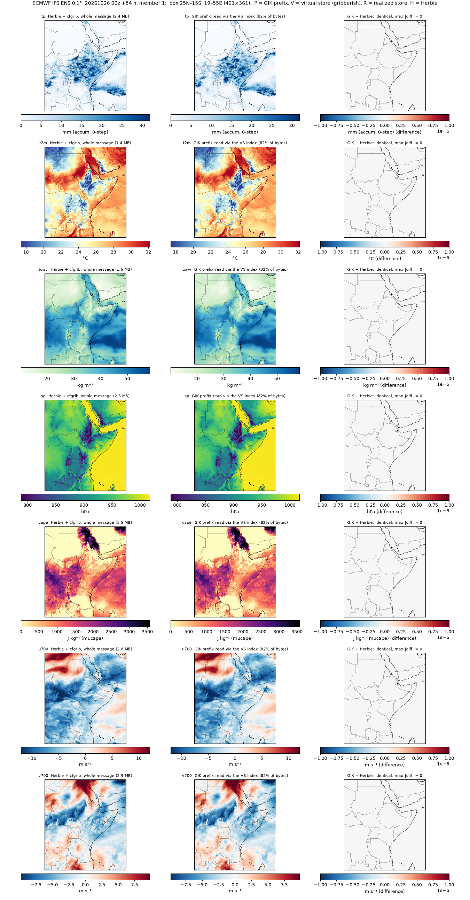

# Herbie vs the GIK latitude subset, 0.1° IFS ENS

This test checks visually that the GIK box subset of a 0.1° message gives the
same values as Herbie for the same message. Seven cGAN fields were compared;
**all are identical, with a maximum |difference| of 0 at every one of the
401 × 361 points.**

Run on 2026-10-30 against cycle **20261026 00z**, at two cases:
- **+54 h, member 1**: inside the 6-hourly SEWAA product's window.
- **+174 h, member 50**: the last step of the 7-day product, in the 6-hourly
  part of the step axis.

The box is 25°N–15°S, 19–55°E (`config.BOX` in
`cGAN_tutorial/ifs-0p1-gik`, commit `bc94087`).

## What is compared

Each field's GRIB message is read four ways and cut to the box:

| | Reader | Bytes | Decoder |
|---|---|---|---|
| **H** | Herbie, `H.xarray(search)`, then `.sel()` to the box | whole message, by its `.index` byte range | cfgrib / eccodes |
| **P** | GIK prefix read, `cgan_dag.read_prefix` | message start → the box's last row (Range GET from the same `.index` the virtual store was built from) | libaec through `ctypes`, from bit 0 |
| **V** | Virtual Icechunk store on source.coop, `cgan_dag.read_virtual` | whole message, through its virtual reference | gribberish codec |
| **R** | Realized store written by `step4_realize.py` (the P reads, 51 members) | — | — |

**H is the independent reference.** It shares no code with the GIK path:
Herbie parses the `.index` itself and eccodes decodes the message. **P** is
how the operational realization reads data. No Rust is involved beyond the
compiled gribberish wheel, which is used only by **V**.

The seven fields are `tp`, `t2m` (`2t`), `tcwv`, `sp`, `cape` (`mucape`),
`u700` and `v700`. They cover the sfc and pl files, an accumulated field,
and both 16- and 24-bit packing.

## Outcome



Each row is one field: Herbie on the left, the GIK prefix read in the
middle, and their difference on the right. The difference panels are blank
because every value is identical.

| Field | +54 h m1: max \|P−H\| / \|V−H\| / \|R−H\| | prefix / whole | +174 h m50: max \|P−H\| / \|V−H\| / \|R−H\| | prefix / whole |
|---|---|---|---|---|
| tp   | 0 / 0 / 0 | 1.98 / 2.42 MB | 0 / 0 / 0 | 2.29 / 2.80 MB |
| t2m  | 0 / 0 / 0 | 1.13 / 1.37 MB | 0 / 0 / 0 | 1.14 / 1.39 MB |
| tcwv | 0 / 0 / 0 | 1.33 / 1.62 MB | 0 / 0 / 0 | 1.32 / 1.61 MB |
| sp   | 0 / 0 / 0 | 2.10 / 2.56 MB | 0 / 0 / 0 | 2.09 / 2.55 MB |
| cape | 0 / 0 / 0 | 1.26 / 1.54 MB | 0 / 0 / 0 | 1.28 / 1.56 MB |
| u700 | 0 / 0 / 0 | 2.32 / 2.83 MB | 0 / 0 / 0 | 2.26 / 2.76 MB |
| v700 | 0 / 0 / 0 | 2.38 / 2.91 MB | 0 / 0 / 0 | 1.75 / 2.14 MB |

The logs are in `out/*.txt`. Only the +54 h figure is in git; the
`.gitignore` drops the others, and the script regenerates them.

**Why 82% of the bytes and not ~60%.** The box's rows (90°N → 15°S) are 58%
of the message. A fresh process asks for that share × 1.35 + 3% on the first
read of a field, because it has not yet learned the field's real need. This
test reads each field once, so every read pays that headroom. A `step4` run
reads a field 51 × N times: it learns the need, then asks for it + 1.5%.
That run measured 32% of the bytes saved for this box (`cGAN_tutorial/ifs-0p1-gik`
README). A short guess costs one more GET, never a wrong value.

## Two Herbie details

- **Edge row and column.** cfgrib's coordinates are float (24.9999…), so a
  label slice `sel(latitude=slice(25, -15))` returns 400 × 360. The script
  selects the 401 × 361 target points by nearest coordinate, with tolerance
  deg/4.
- **503 Slow Down.** Herbie falls back to GCS only when a file is missing,
  not when S3 throttles. The retry loop alternates `aws` and `google`, which
  hold byte-identical copies. The GIK reader does the same.

## Reproduce

```bash
uv venv -p 3.12 venv-herbie
VIRTUAL_ENV=venv-herbie uv pip install -r ~/cGAN_tutorial/ifs-0p1-gik/requirements.txt \
    herbie-data cfgrib eccodes matplotlib cartopy
# R needs a realized store for the cycle (cGAN_tutorial/ifs-0p1-gik run_local.sh); omit --realized to skip it
IFS0P1_GIK=~/cGAN_tutorial/ifs-0p1-gik venv-herbie/bin/python herbie_vs_gik.py \
    --date 20261026 --run 00 --step 54 --member 1 \
    --realized /srv/state/ifs0p1/icechunk/ecmwf-ifs-0p1-cgan14-19e55e-25n15s/20261026T00z-jurre-6h+mvua-7d \
    --out out/herbie_vs_gik_20261026T00z_54h_m1.png | tee out/herbie_vs_gik_20261026T00z_54h_m1.txt
```

Versions used: herbie-data 2026.10.0, cfgrib 0.9.15.1, eccodes 2.50.0,
gribberish 1.6.0, icechunk 2.1.1, xarray 2026.7.0, imagecodecs 2026.10.10,
cartopy 0.26.0.

A member is 1–50 (`enfo`); member 0, the control, is in `oper` and is not
covered by this script's Herbie search.
