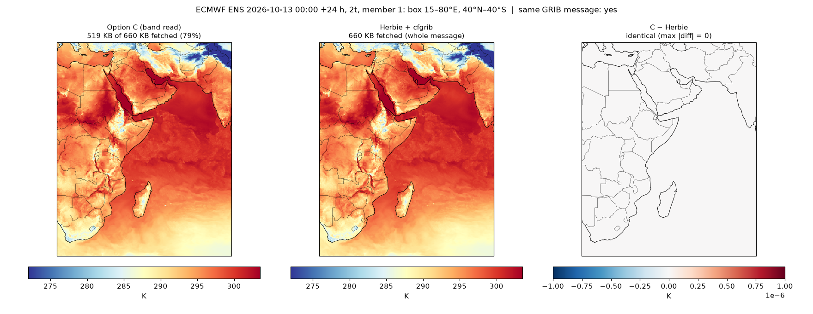
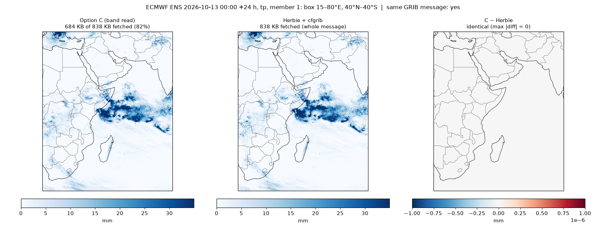
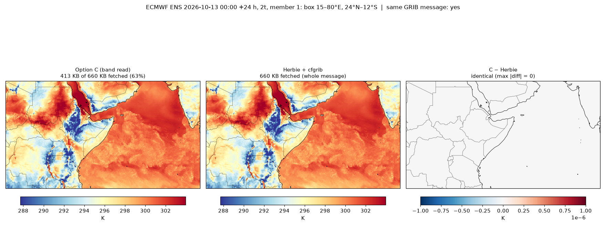

# Option C: read the band from the message start, with no search

The first RSI starts at bit 0 of the packed data. Reading from the **message
start** down to the end of the band therefore needs no bit search, no stored
offsets and no value match. Per message (`prefix_read.py`):

1. **One GET** from the message start to the template-predicted end of the
   band's last RSI, plus 1.5% of the message and 2 KiB.
2. **Decode from bit 0** with libaec offset capture, stopping at the band's
   last row.
3. **If the bytes ran out** first, GET the next piece (2% + 4 KiB) and decode
   again. A short guess costs bytes, never a wrong answer.

The same decode returns the **exact RSI offsets** from the top to the band
end. That is the par row or sidecar a later exact-band read (~50%) needs, at
no extra cost.

The template only sets the first GET's length. A missing or stale template
means a second GET, not an error.

## Result on the real pars

Every message was checked against a full read: the band values against
eccodes, and the captured offsets against the true ones.

| Run | Band | Template | Exact | Fetched (mean, min–max) | Extra GETs |
|---|---|---|---|---|---|
| test 20261013 | 40°N → 40°S | 20261012 (1 day) | **94 / 94** | **77.3%** (73.1–81.7) | 0 |
| test 20261017 | 40°N → 40°S | 20261016 (1 day) | **94 / 94** | 77.5% (73.0–81.8) | 0 |
| test 20261013 | 40°N → 40°S | **20260513 (5 months)** | **94 / 94** | 76.4% (71.7–81.0) | 2 |
| test 20261013 | **24°N → 12°S** | 20261012 | **94 / 94** | **60.5%** (57.7–63.7) | 0 |

**376 / 376 exact.** Each run covers 5 fields (`2t tp msl t/850 u/700`):

- ens_01 at 11 steps from 0 to 360 h;
- 7 other members and the control at 24 h.

`tp` at 0 h is a constant field, which needs no packed data.

By field (40°N → 40°S, 1-day template): `msl` 73%, `t/850` 77%, `u/700` 77%,
`2t` 79%, `tp` 81%.

Outputs: `../out/c_prefix_*.txt`.

```bash
GIK_CHUNK_SOURCE=gcs uv run c_prefix/prefix_read.py <template par> <test par>... [--lat 40,-40] \
    [--save 2t:24:c_2t_24.npz]
```

## Compared with Herbie, same GRIB message

`plot_compare.py` downloads the same message with Herbie: same `.index`
offset and length, decoded by cfgrib. Both are cut to the same box and
compared value for value (float32).

| Field, member 1, 20261013 00z +24 h | Box | Option C fetched | Herbie fetched | Difference |
|---|---|---|---|---|
| `2t` | 15–80°E, 40°N–40°S (`ea-sw-io40`) | 519 KB (78.6%) | 660 KB (whole message) | **identical** |
| `tp` | same | 684 KB (81.7%) | 838 KB | **identical** |
| `2t` | 15–80°E, 24°N–12°S | 413 KB (62.6%) | 660 KB | **identical** |





```bash
uv run c_prefix/plot_compare.py c_2t_24.npz "2026-10-13 00:00" 24 2t 1 out/c_prefix_vs_herbie_2t_24h.png
```

## Option C against the other reads

| Read per message | Search | Exact here | 40°N → 40°S | 24°N → 12°S |
|---|---|---|---|---|
| full message (today, Herbie, GIK) | no | — | 100% | 100% |
| **C: message start → band end** | **no** | **376 / 376** | **~77%** | **~61%** |
| v5: window + count to the end | yes (Rust 30 ms – 2 s) | 376 / 376 | ~77% | ~64% |
| v5: `tp` counted, others value match | yes | 188 / 188 (1-day template only) | ~62% | — |
| exact band (offsets already stored) | no | 425 / 425 | ~50% | ~23% |

- **C costs the same as count-to-end** for 40°N → 40°S, and less for East
  Africa's latitudes.
- **C has no search, no value match and no reliance on template age.** It
  should be the realization's first read.
- **Only the value-match policy fetches less without stored offsets** (~62%).
  It needs a 1-day template and the search, and its errors are silent.
- **C's offsets go into the par.** Every later read of that message is then
  the exact band.
- **C fits a standard Icechunk virtual chunk:** `[url, message offset,
  length to the band end]`. It needs a codec that decodes only the first N
  rows of a cut-off message (`../../lat-band-par/README.md`).

## Any latitude extent: only the south edge matters

ECMWF scans north → south, so a prefix read always starts at 90°N. Its cost
is set by the band's **south edge**; the north edge changes nothing.
Measured by `manifest_margin.py` on 94 messages of 20261013 00z (5 fields;
ens_01 at 11 steps, 7 other members and the control at +24 h), full reads:

| South edge | Bytes from the message start (mean, min–max) |
|---|---|
| 40°N | 26.5% (24.4–28.4) |
| 20°N | 39.0% (36.4–41.5) |
| 0° | 51.5% (49.3–54.2) |
| **12°S** | **58.8%** (55.7–62.2) |
| 20°S | 63.8% (59.9–67.4) |
| **40°S** | **75.5%** (71.1–79.8) |
| 60°S | 86.9% (83.6–92.0) |

These are the exact minimum lengths, before any margin. Decoding **exactly**
that many bytes gave the full band on 94/94 messages at 12°S and 94/94 at
40°S, which is the case a prefix codec would meet.

So for the ICPAC boxes:

| Box | South edge | Prefix cost |
|---|---|---|
| `ea` (25.25°N → 15.25°S) | 15.25°S | ~61% |
| `ea-sw-io`, `ea-sw-io40` (to 40°S) | 40°S | ~76% |
| 24°N → 12°S | 12°S | ~59% |
| a Sahel band (to 5°N) | 5°N | ~48% |
| any box reaching 60°S | 60°S | ~87% |

- **A new extent needs no new test or template.** The template profile holds
  every RSI's offset, so it predicts the band end for any south edge.
- **Bands far south gain little.** For a southern-hemisphere box, only the
  exact band read (stored RSI offsets, `../../lat-band-par/`) saves much, and
  that does not fit a plain virtual chunk.
- **The rows north of the band are fetched and decoded,** then dropped by
  `.sel`. Decode time scales with the rows kept, so a 40°S prefix decodes
  ~76% of the samples.
- **Longitude is still the whole 360°.**
- 0.1° should behave the same (rows 0…N of 1801), but it is not tested yet.

## Way forward: a prefix group in the Icechunk virtual store

The realization (`../../../ewc-realization/frisky_daily_dag.py`) reads
through the GIK Icechunk virtual store: `_open_era` opens the `{era}/00z`
group, and `read_message` does `.sel(latitude=slice(40, -40), ...)`. The
gribberish codec decodes each whole-message chunk. Option C fits that design
as a **second group with shorter chunks**, with no RSI offsets stored
anywhere:

```
stage ① template (once per era, or refreshed monthly; see below)
    one full read per (field, level, step), one member
      → RSI end profile: fraction of the data section at each RSI end
        (~255 floats per field and step at 0.25°)

stage ② index → virtual store (unchanged, plus one group per south edge)
    {era}/00z            [url, offset, length]          whole message (as now)
    {era}/00z-s40        [url, offset, prefix_len]      rows 90°N → 40°S
        prefix_len = d0 + profile[k_end] × (length − d0) + 3% × length + 4 KiB
        array latitude 90 → −40 (521 rows at 0.25°), chunk (1, 1, 1, 521, 1440)
        codec: gribberish, rows=521
    still no GRIB bytes read in stage ②

stage ③ realization
    _open_era → group "{era}/00z-s40"; read_message unchanged
    codec reports a short chunk → read that message from "{era}/00z" instead
```

What each part needs:

| Part | State |
|---|---|
| `prefix_len` from the `.index` length and a template profile | measured here (below) |
| exact band from a truncated message, decoded from bit 0 | **376/376** (`prefix_read.py`), and 188/188 at the exact minimum length |
| gribberish codec option `rows=N`, tolerant of a short Section 7, raising if the bytes stop before row N | **not built**: drafted as gribberish Issue 2 (`../../gribberish-issue-drafts.md`) |
| stage ② writing the extra group | not built: same refs, two more columns |
| realization fallback to the whole-message group | not built: a `try/except` around `.values` |

**How big a margin a manifest needs.** Stage ② writes `prefix_len` before
anyone reads the message, so it cannot top up a short guess the way
`prefix_read.py` does. Margin needed over the template prediction, as a % of
the message (94 messages × 7 south edges = 658 cases):

| Template age | median | p99 | max | short at 1.5% + 2 KiB | short at 3% + 4 KiB |
|---|---|---|---|---|---|
| 1 day (20261012) | +0.13 | +1.10 | +1.87 | 0 | **0** |
| 3 days (20261010) | +0.03 | +1.02 | +1.99 | 1 | **0** |
| 1 month (20260917) | +0.60 | +2.32 | +2.64 | 25 | **0** |
| 4 months (20260617) | +1.14 | +2.51 | +2.90 | 73 | **0** |
| 5 months (20260513) | +1.05 | +3.25 | +3.85 | 98 | 1 (`tp`) |

- **3% + 4 KiB with a template up to 4 months old: 0 short in 658.** It adds
  ~3.5% to the fetch: ~79% instead of 75.5% for 40°S, ~62% for 12°S.
- Older templates drift upward: messages grow relative to the template's
  profile. Refreshing the profile monthly (one full read per field and step,
  about 1 in 51 messages of one run) keeps 3% + 4 KiB safe.
- A short chunk is not a silent error. The codec must raise, and the
  realization falls back to the whole message.
- One test date (20261013); the margin table should be repeated on more
  dates and at 0.1° before stage ② relies on it.

**Until the codec exists**, the realization can take the same saving now by
calling the `prefix_read.py` logic in `read_message` instead of the virtual
store. It has the par ref, one GET of `prefix_len`, a libaec decode from
bit 0, and a top-up GET when short. That costs one dependency (libaec ≥ 1.1,
already in the imagecodecs wheel) and no store change.

**Later reads.** The prefix decode also returns the exact RSI offsets. They
can tighten `prefix_len` in a later Icechunk commit, or go into a sidecar
for exact-band re-reads (~50% for 40°N–40°S). Neither is needed for the
realization's own read.

```bash
GIK_CHUNK_SOURCE=gcs uv run c_prefix/manifest_margin.py <test par>... \
    --templates <par>... [--south 40,20,0,-12,-20,-40,-60]
```

Output: `../out/c_prefix_manifest_margin_test20261013.txt`.
